# terrain-park

Human terrain motion for humanoid robots, and the terrain fitted to it. One person walking over, onto and up everyday
props (logs, steps, a two-step stair, a ramp onto a step, a sloped driveway) was captured with a Pico headset and
foot trackers, and every take is retargeted to the AgiBot X2 Ultra. Props are fitted to where the feet actually went,
as plain boxes and slopes, so each motion comes with terrain it fits.

The repo also holds the terrain the X2 perception policies trained and were scored on: the extended training map (procedural
8 x 8 m tiles of everyday props, with checked routes), the props it and the apparatus are built from, and our own model of the
IEEE Humanoids 2026 loco-manipulation apparatus with its eval route.

**Status: first version (2026-10-30); training terrain and apparatus added 2026-11-15.** The captures and X2 motions are
complete; the props and the contact quality are being iterated (see Known issues).

## Pictures

**Pico captures**: a person walking over real props at home (logs, a 4x4 beam, a ramp, the driveway and two sets of steps), retargeted to the X2 and replayed in MuJoCo. More in [`catalog/`](catalog/).

| 2x2 log, straight over | 4x4 beam, sidestep over | Ramp, straight up |
|---|---|---|
| 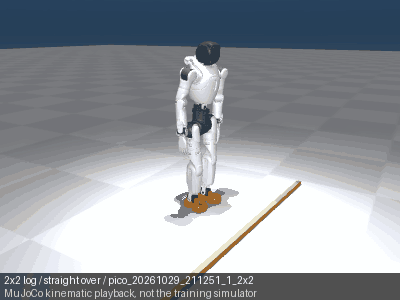 | 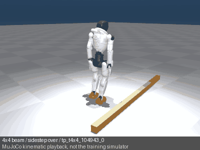 | 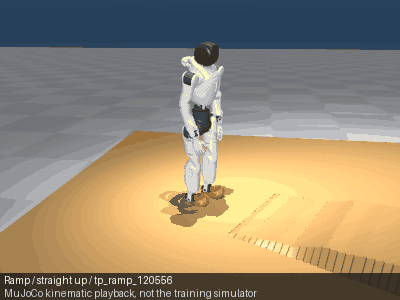 |
| **Driveway, uphill** | **Steps (place 1), C-turn up** | **Steps (place 1), straight down** |
| 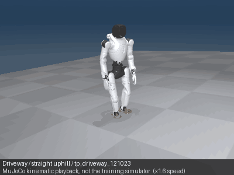 | 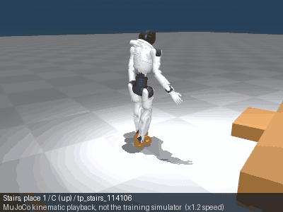 | 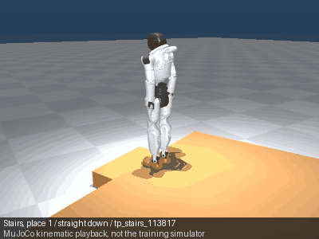 |

**Extended training map** ([`terrains/`](terrains/)): 8 x 8 m tiles of everyday props, each type in easy, medium and hard rows.

| Whole map | New section (homes, street, stairs) |
|---|---|
| 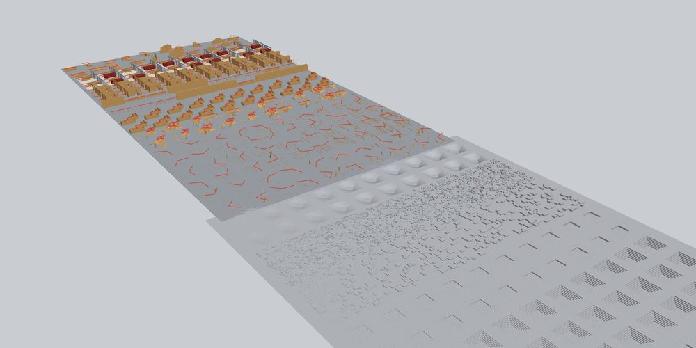 | 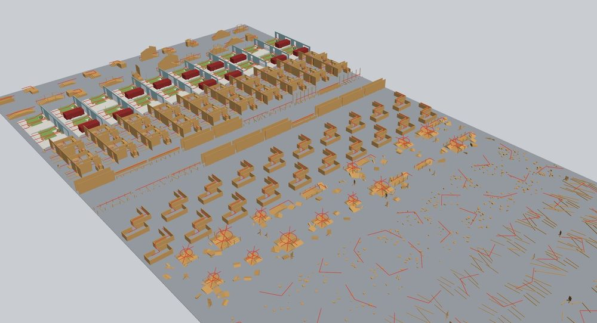 |
| **Stairs (straight, L, U, spiral)** | **Homes** |
| 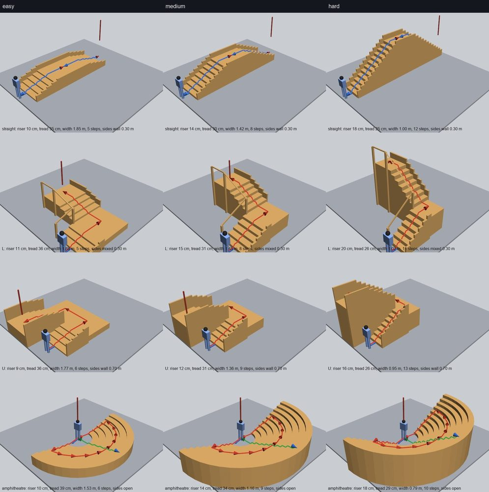 | 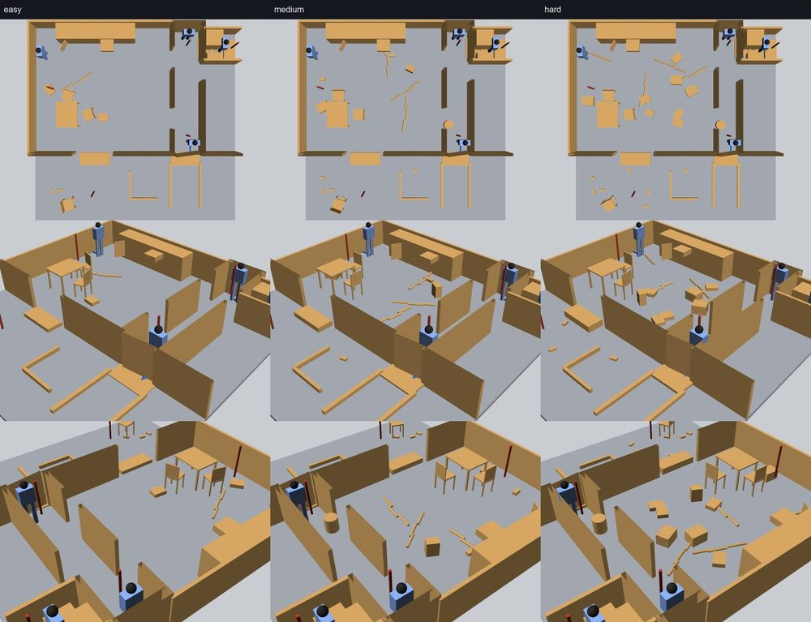 |
| **Street** | **Wedges and ramps** |
| 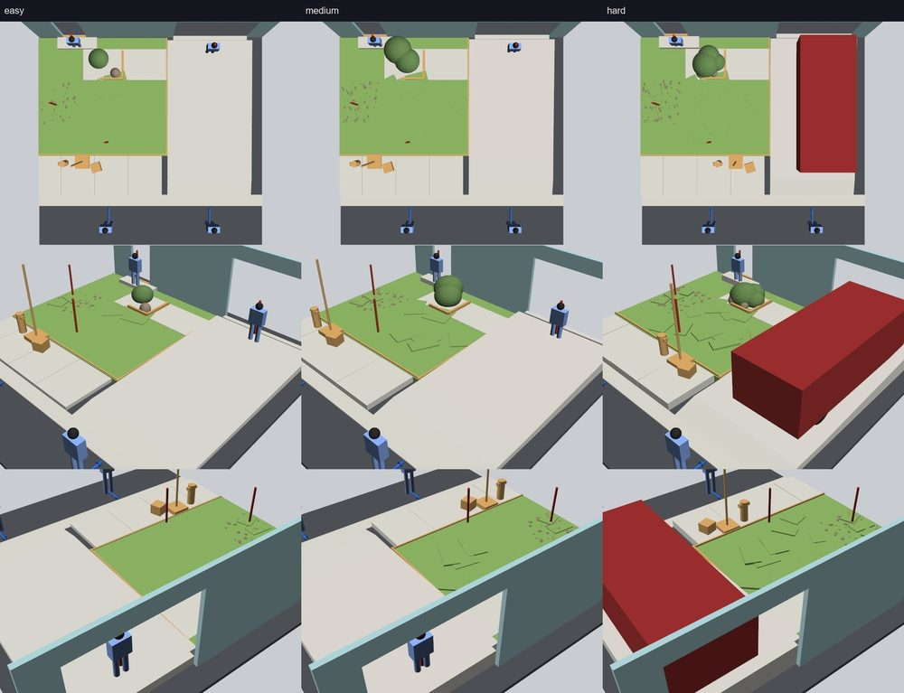 | 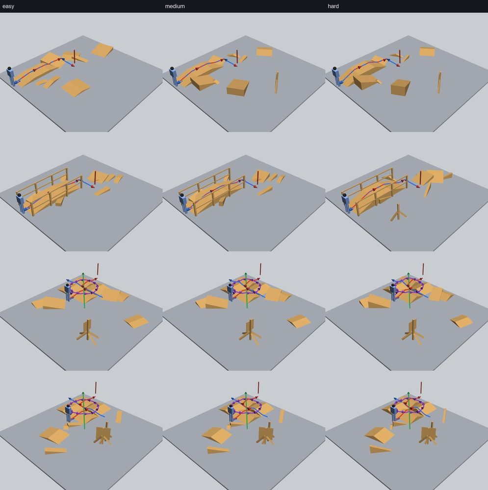 |
| **Beams and blocks** | **Log corridors** |
| 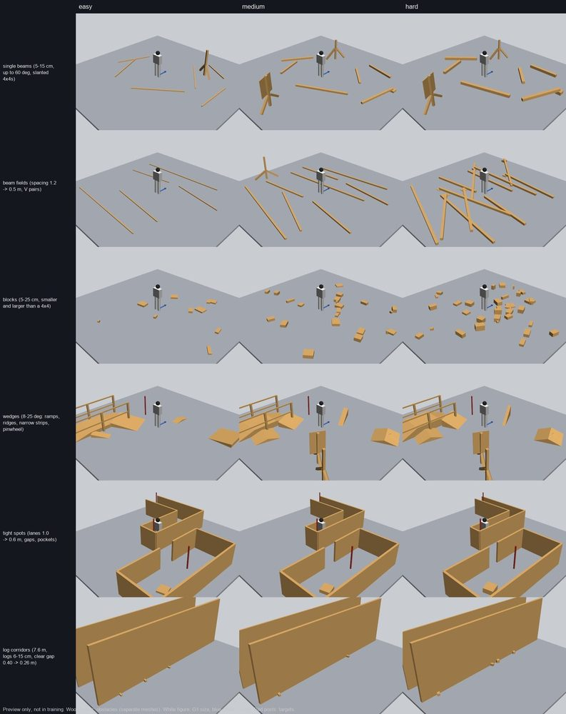 | 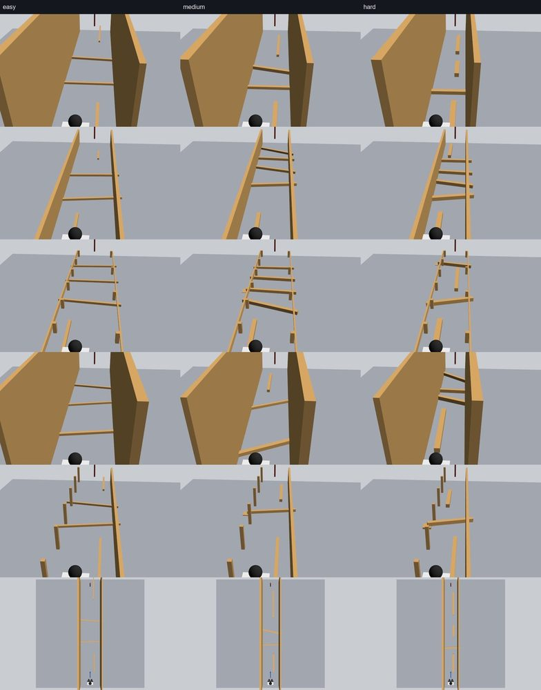 |

**Our apparatus** ([`apparatus/ours/`](apparatus/ours/)): our build of the IEEE Humanoids 2026 loco-manipulation course, as CAD and in MuJoCo.

| Whole course and mobile gantry | Walking over the 4x4s |
|---|---|
| 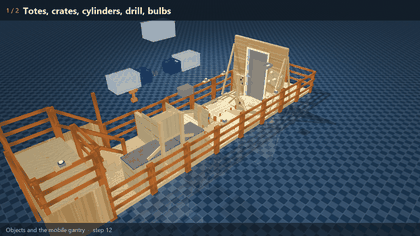 | 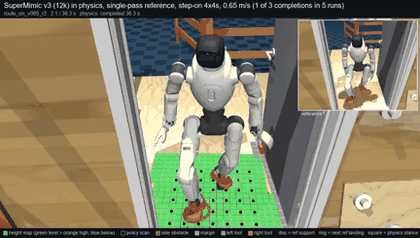 |
| **Building the stairs** | **Building the terrain section** |
| 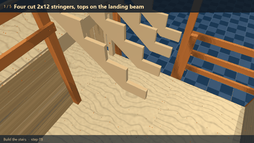 | 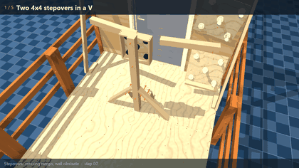 |

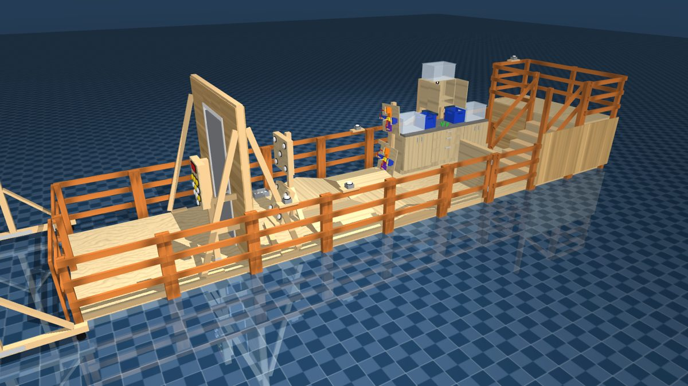
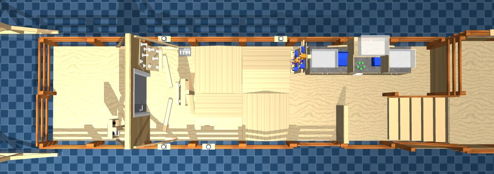

## What is here

| Folder | What | Load |
| --- | --- | --- |
| `data/2026-10-29/`, `data/2026-10-30/` | Pico captures (raw and retargeted to the X2) and the props fitted to them | below, "Formats" |
| `data/train_sets/` | Ready-to-train X2 clips, each with the terrain it was captured on (and left-right mirrored sets) | `data/train_sets/README.md` |
| `data/style/` | Pico style clips (flat walk, ramp, logs, stairs, turn in place, side walk) for style rewards, `pico_style_v1.pkl` | `pico_style_v1_meta.json` (made by `tools/style/`) |
| `catalog/` | Visual catalogue of the Pico takes (`index.html`) | open in a browser |
| `terrains/` | The extended training map: `extended_v1` (330 tiles, 9 types, 10 levels) and `extended_v4k` (the trained set: inset stairs, 2,382 routes), and the generator code | `terrains/README.md` |
| `props/` | Every prop's geometry parameters: 4x4 timbers, wedges and ramps, blocks, stairs, beams, rails, walls (map in metres, apparatus in inches) | `props/README.md` |
| `apparatus/ours/` | Our apparatus: parametric CAD, Fusion 360 scripts, MuJoCo model, eval raster, 344 wall boxes and the 22-waypoint route, build guide and BOM | `apparatus/README.md` |
| `apparatus/NIST.md` | Where to get the official NIST testbed (not included) and how our eval imports it | |
| `tools/` | Prop fitting, mirroring, validation and a MuJoCo prop viewer | below, "Using the tools" |

Sizes: Pico data and catalogue about 170 MB; `terrains/` 18 MB, `apparatus/` 2.6 MB (no file over 4 MB).

## Models trained on this terrain

| Model | Where |
| --- | --- |
| ACP contact planner + tracker for the X2 | [tinkerbuggy/x2-acp-contact-planner-tracker](https://huggingface.co/tinkerbuggy/x2-acp-contact-planner-tracker) |
| Hiking in the Wild, ported to the X2 | [tinkerbuggy/x2-hiking-in-the-wild](https://huggingface.co/tinkerbuggy/x2-hiking-in-the-wild) |
| SSR for the X2 | [tinkerbuggy/x2-ssr](https://huggingface.co/tinkerbuggy/x2-ssr) |
| Training and eval code | [meetsitaram/x2-perception](https://github.com/meetsitaram/x2-perception) |

## Pico captures

| Path | What |
| --- | --- |
| `data/<date>/raw/record_*.npz` | Raw Pico takes: 24 SMPL joints per sample (positions + orientations), headset and controllers |
| `data/<date>/x2/record_*.npz` | Every take retargeted to the X2 (floor rules: feet flattened near the floor) |
| `data/2026-10-30/x2_body_to_body/` | Stair and ramp takes retargeted body to body (no floor rules), for terrain |
| `data/2026-10-30/props/` | Fitted props: `stairs_location2.json`, `ramp.json` (X2 scale), `driveway.json` + `driveway_20mm.npz` (human scale) |
| `data/2026-10-30/raw/takes.json` | Per take: station, headset frame, type (survey, A/B/C step-over approach, ...) |
| `data/2026-10-29/props.json` | The 4x4 beam of the first session (human scale) |
| `tools/` | Prop fitting (`fit_stairs_x2.py`, `fit_ramp_x2.py`) and a MuJoCo viewer (`view_props.py`) |

About 190 takes in all: 38 on 2026-10-29 (stepping over a 4x4), 149 on 2026-10-30 (a 4x4 T laid out as two beams,
a two-step stair at two places, a folding ramp onto an outdoor step, a driveway).

## Formats

**Raw take** (`raw/record_*.npz`): `stamp_ns` (N,) sample times, ~76 Hz (body poses repeat between tracker updates);
`body` (N, 24, 7) SMPL joints, position xyz + quaternion xyzw, Unity frame (y up), metres; `body_ok` (N,);
`headset`, `lctrl`, `rctrl` (N, 7); `axes`, `buttons`, `analog`; `floor_y` floor height, set from a still,
feet-flat standing moment (NaN if not set yet); `floor_source`, `floor_stamp_ns`; `t0_wall_unix_s`. Positions are in
the headset's world frame, which holds within a session until the headset re-centres or reconnects.

**X2 take** (`x2*/record_*.npz`): `t` (N,) seconds from the take start; `qpos` (N, 38): root xyz, root quaternion
wxyz, 31 joints in the MuJoCo order of the X2 model (`agibot-x2-record-and-replay/sim/x2_ultra.xml`);
`height_scale` the X2 / human height ratio used (0.669 on 2026-10-29, 0.718 on 2026-10-30); `floor_y`. One X2 frame
per raw sample. Head and wrist joints are not tracked by Pico: zero them before training.

**Props**: `kind: stairs` (origin = front edge of step 1 at the floor, yaw, width, steps of rise / run / top),
`kind: ramp` (origin = foot of the slope, yaw, width, slope_run, rise, deck_run), in the X2 world of the takes they
list. The driveway is a height grid (`x0`, `y0`, `res`, `grid`) at human scale in the Pico frame.

## Retargeting

GMR-style segment morph + two-stage mink IK (`x2_ik.X2Retargeter` in agibot-x2-record-and-replay), with the human
stance width scaled to the X2. The root's world position is scaled by the height ratio, so the X2 walks a shorter
path than the person: props are fitted to the X2's own feet, not scaled from the human's. `x2/` uses the live
viewer's floor rules (planted feet flattened near the floor, swing feet kept in the knee plane); on a step those rules
misread a planted foot as swinging, so terrain takes are also given body to body (`x2_body_to_body/`), where every X2
body follows its human body.

## Known issues

- **Pico estimates the feet.** Foot height and tilt wander: 88% of planted-foot frames on the stairs are within 2 cm
  of the fitted tread, 58% on the ramp; feet stay level on the 10 deg ramp instead of tilting with it. Next: contact
  clean-up (a planted foot set on the surface its human foot stands on, sole parallel to it, the leg solved around
  it), as in interaction-preserving retargeting (OmniRetarget).
- Three ramp takes start on the outdoor step, which the ramp prop does not include yet.
- The 4x4 T of the first 2026-10-30 block was raised for practice; feet planted under it, so as a floor-level 4x4 some
  crossings collide. The block on the floor (11:19-11:25) does not have this.

## Using the tools

```
pip install mujoco numpy
set X2_RECORDER=<path to agibot-x2-record-and-replay>   (default: a sibling folder of this repo)
python tools/view_props.py data/2026-10-30/x2_body_to_body data/2026-10-30/props/ramp.json
```

## License

Apache-2.0 (LICENSE), code and data: the Pico captures, the extended map and its generators, the props and our apparatus
design are our own work.

Not included and not covered: the official NIST testbed CAD and the challenge spec and rules, which belong to the organisers
(see `apparatus/NIST.md`), and the X2 robot model (AgiBot).
