# Pico terrain captures: catalogue by prop and approach shape

Generated by `python catalog/make_catalog.py` (working tree only). 131 takes on 6 props; every take with its category and numbers is in `categories.json`.

| Prop | Takes | Categories (takes) |
| --- | --- | --- |
| 4x4 beam | 56 | straight over (14), oblique over (1), turn, then cross (7), cross, then turn (10), C / U turn (6), S turn (1), sidestep over (9), backward over (3), no crossing (5) |
| 2x2 log | 10 | straight over (3), oblique over (3), turn, then cross (1), C / U turn (1), no crossing (2) |
| Stairs, place 1 | 38 | straight up (10), straight down (9), single step up, straight (4), single step down, straight (4), side approach then up (2), down then turn (2), C (up) (2), C (down) (2), S (up) (2), S (down) (1) |
| Stairs, place 2 | 6 | single step up, straight (3), single step down, straight (1), down then turn (2) |
| Ramp | 15 | straight up (3), oblique up (1), straight down (2), oblique down (1), down, then turn (1), over the ramp side to side (7) |
| Driveway | 6 | straight uphill (2), straight downhill (1), diagonal across the slope (3) |

## How the takes were grouped

Every take is put in a frame fixed to its prop (origin at the prop, +x = the crossing direction) and measured there:

- **body** = pelvis heading, **path** = direction of travel, both against +x at the crossing (`body_x`, `path_x`).
- **turn before / after** = change of the body heading from the start to the crossing and from the crossing to the end.
- **sideways / backward share** = share of the travelled distance with the travel direction 50 to 130 deg / over 130 deg off the body heading.
- Beams (4x4, 2x2 log): crossing = the root passing the beam line within the beam's length. Rules, first match wins: no crossing; more than one
  crossing (over and back); travel 50 to 130 deg off the body at the crossing (sidestep over); over 130 deg (backward over); a body turn of
  40 deg or more both before and after (C / U turn if the same way, S turn if opposite ways); only before (turn, then cross); only after
  (cross, then turn); body 25 deg or more off square, or path 35 deg or more (oblique over); otherwise straight over.
  Each beam take is turned by 180 deg if needed so that it crosses towards +x; nothing is mirrored, so left and right turns stay apart in the panels.
- Stairs: the class comes from `data/train_sets/tp_stairs_all_v1_meta.json` (per take: levels touched, turn on the floor, turn on the top, facing
  against the stair line); it was not re-derived here. Numbers added: root height gain, sideways share, duration.
- Ramp (15 base takes of `acp_tp_ramp_sh2_x30.pkl`, names without `_sh`): root height gain under 0.10 m from start to end = over the ramp
  side to side (floor, a few centimetres up the slope, floor again); otherwise up or down, with "turn" for a body turn of 40 deg or more before or after the slope and "oblique" for body or path
  25 deg or more off the slope line.
- Driveway (6 takes, `data/2026-10-30/x2`, resampled to 50 fps): net travel within 30 deg of uphill / downhill = straight, otherwise diagonal. The
  ground is a plane fitted here to the X2's own planted feet (4.5 deg); `props/driveway.json` is at human scale.

In the forward step-overs the travel direction sits a steady 10 to 20 deg to the left of the pelvis heading (`body_vs_path` in `categories.json`),
on both capture days and whichever way the beam is crossed, while the sidestep takes are square to the beam. That looks like a pelvis-yaw offset
of the retarget rather than a property of the walks; "oblique" is therefore decided on the body heading first.

GIFs are MuJoCo kinematic playback (root pose and 31 joints set per frame, no physics, not the training simulator), camera three-quarter view
following the root, 12.5 fps. The ramp is drawn from the training height map (`tp_ramp_hmap_x30.npz`) in the plots and in the GIFs, and
the ramp frame (origin at the foot of the slope, +x up) is taken from that map too. `props/ramp.json` shifted by +30 m is a different fit: about
2.2 m wide and turned against the height map's slope (`ramp_frame` in `categories.json` has the difference); the height map's ramp is about 0.8 m wide.

## 4x4 beam (56 takes)

Earlier classification: 17 straight, 19 L turns, 9 sideways walks, 4 C / U turns, 3 S, 4 oblique (by net body yaw and sideways share, not relative to the beam).

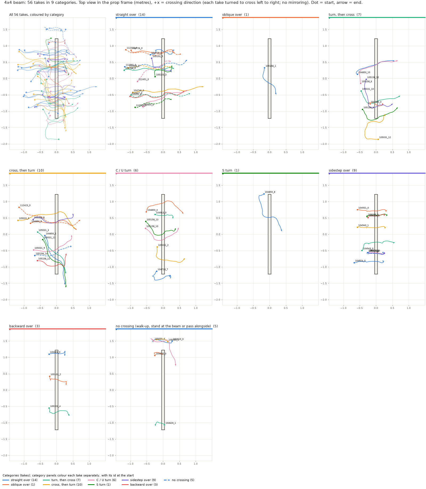

| Category | Takes | abs body x | abs path x | abs turn before | abs turn after | sideways share | backward share | seconds | Take ids |
| --- | --- | --- | --- | --- | --- | --- | --- | --- | --- |
| straight over | 14 | 2 (0 to 20) | 18 (11 to 34) | 11 (4 to 29) | 8 (0 to 19) | 0.00 (0.00 to 0.41) | 0.00 (0.00 to 0.00) | 5.0 (3.3 to 5.8) | 104718_2, 104726_0, 104736_0, 104746_0, 104850_0, 105103_3, 105103_5, 112251_0, 112302_0, 112315_0, 112347_0, 112444_0, 112451_0, 112501_0 |
| oblique over | 1 | 72 | 36 | 15 | 3 | 0.00 | 0.00 | 2.4 | 105158_1 |
| turn, then cross | 7 | 9 (1 to 20) | 18 (3 to 24) | 65 (54 to 148) | 13 (2 to 38) | 0.03 (0.00 to 0.26) | 0.00 (0.00 to 0.00) | 3.7 (3.0 to 5.3) | 104850_10, 104900_0, 105031_10, 105031_12, 105158_6, 105158_9, 105158_12 |
| cross, then turn | 10 | 16 (5 to 69) | 19 (0 to 37) | 8 (4 to 28) | 77 (47 to 102) | 0.00 (0.00 to 0.14) | 0.00 (0.00 to 0.00) | 3.8 (2.9 to 5.2) | 104850_1, 104850_9, 105031_3, 105031_5, 105031_9, 105031_11, 105158_8, 105158_11, 105158_14, 112423_0 |
| C / U turn | 6 | 12 (1 to 37) | 16 (0 to 23) | 56 (44 to 92) | 66 (47 to 84) | 0.06 (0.00 to 0.18) | 0.00 (0.00 to 0.00) | 3.5 (3.0 to 5.4) | 104718_7, 104850_4, 104913_0, 105031_2, 105158_10, 105158_13 |
| S turn | 1 | 16 | 5 | 121 | 64 | 0.04 | 0.00 | 4.5 | 104850_8 |
| sidestep over | 9 | 84 (76 to 94) | 4 (2 to 8) | 5 (1 to 10) | 7 (3 to 11) | 1.00 (0.80 to 1.00) | 0.00 (0.00 to 0.00) | 3.2 (2.5 to 5.2) | 104924_0, 104931_0, 104943_0, 104943_1, 105210_0, 105215_0, 105219_0, 105224_0, 105230_0 |
| backward over | 3 | 155 (148 to 177) | 14 (1 to 16) | 8 (1 to 20) | 12 (10 to 13) | 0.25 (0.20 to 0.28) | 0.75 (0.72 to 0.80) | 3.4 (2.7 to 3.6) | 105103_0, 105103_2, 105103_4 |
| no crossing (walk-up, stand at the beam or pass alongside) | 5 | - | - | - | - | 0.00 (0.00 to 0.17) | 0.00 (0.00 to 0.00) | 2.9 (0.9 to 4.2) | 104610_0, 104620_0, 104620_1, 105031_1, 105031_4 |

Median (min to max) over the takes of the category; abs = absolute value. Ids are short for `tp_t4x4_104610_0`.

### 4x4 beam: straight over (14)

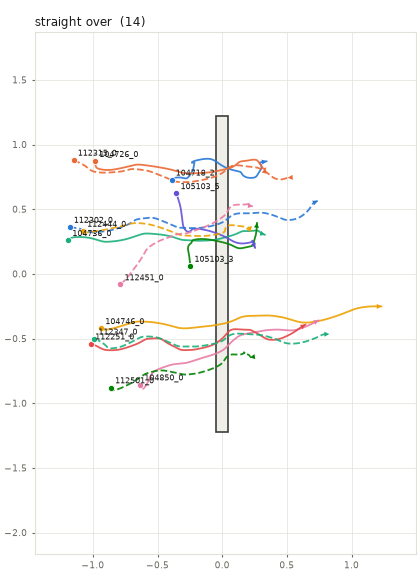 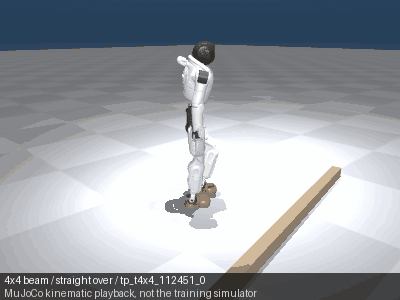 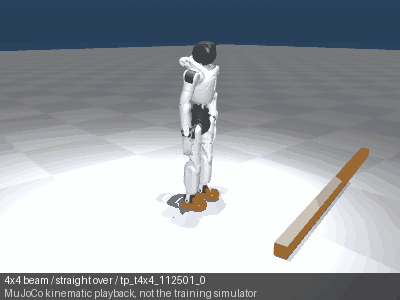

GIFs: `112451_0` medoid (typical); `112501_0` farthest from the medoid.

### 4x4 beam: oblique over (1)

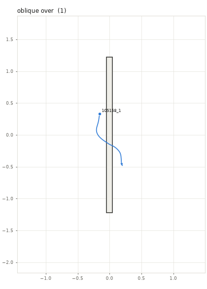 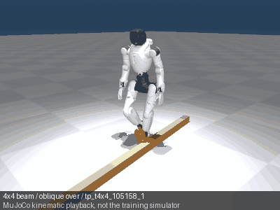

GIFs: `105158_1` medoid (typical).

### 4x4 beam: turn, then cross (7)

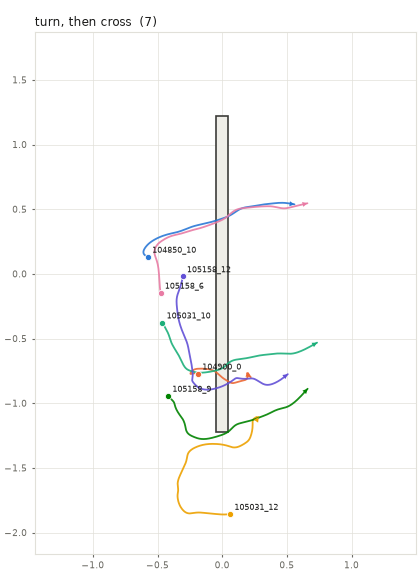 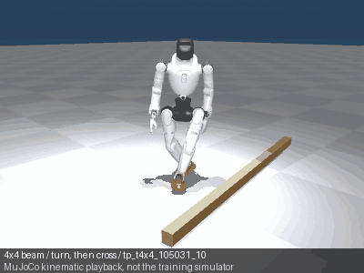 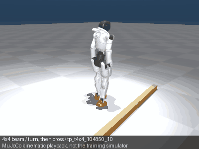

GIFs: `105031_10` medoid (typical); `104850_10` farthest from the medoid.

### 4x4 beam: cross, then turn (10)

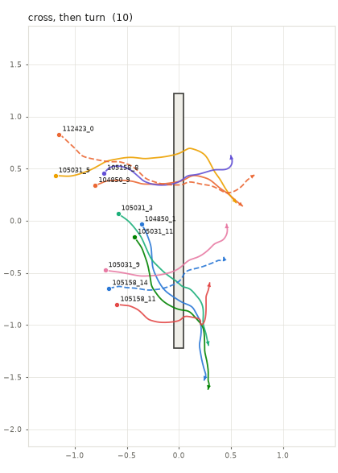 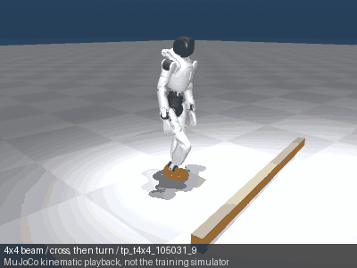 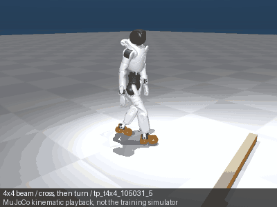

GIFs: `105031_9` medoid (typical); `105031_5` farthest from the medoid.

### 4x4 beam: C / U turn (6)

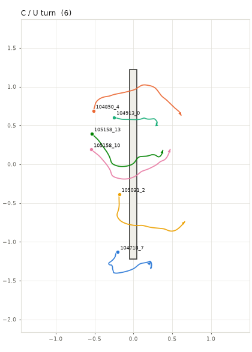 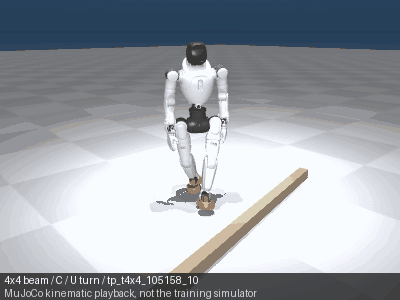 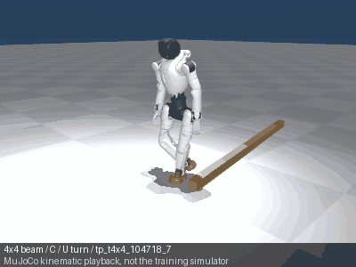

GIFs: `105158_10` medoid (typical); `104718_7` farthest from the medoid.

### 4x4 beam: S turn (1)

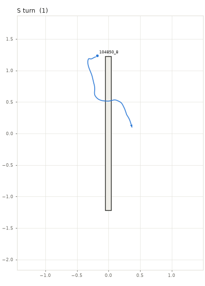 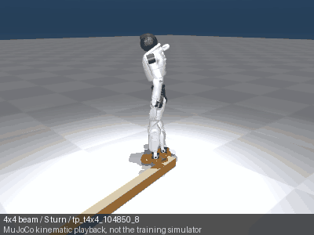

GIFs: `104850_8` medoid (typical).

### 4x4 beam: sidestep over (9)

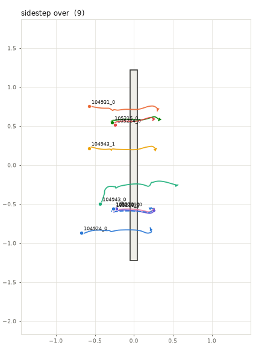 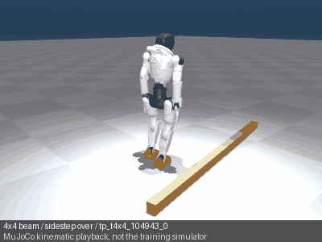 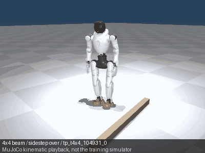

GIFs: `104943_0` medoid (typical); `104931_0` farthest from the medoid.

### 4x4 beam: backward over (3)

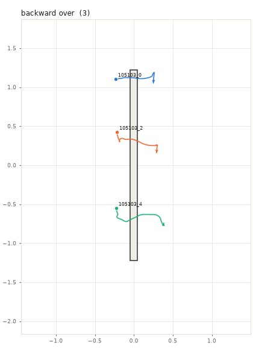 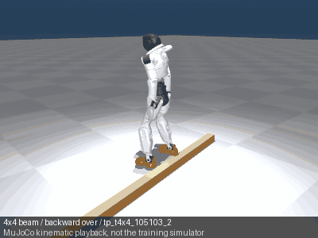

GIFs: `105103_2` medoid (typical).

### 4x4 beam: no crossing (walk-up, stand at the beam or pass alongside) (5)

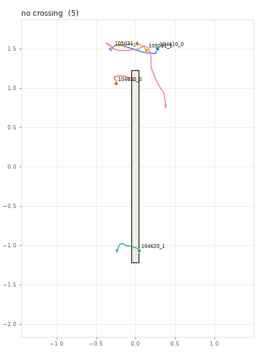 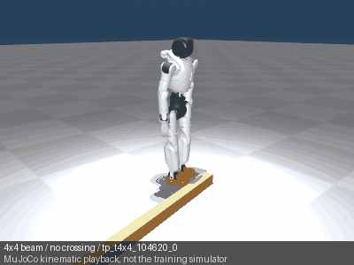 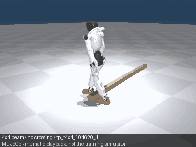

GIFs: `104620_0` medoid (typical); `104620_1` farthest from the medoid.

## 2x2 log (10 takes)

Earlier classification: 6 straight, 2 C, 1 L, 1 oblique.

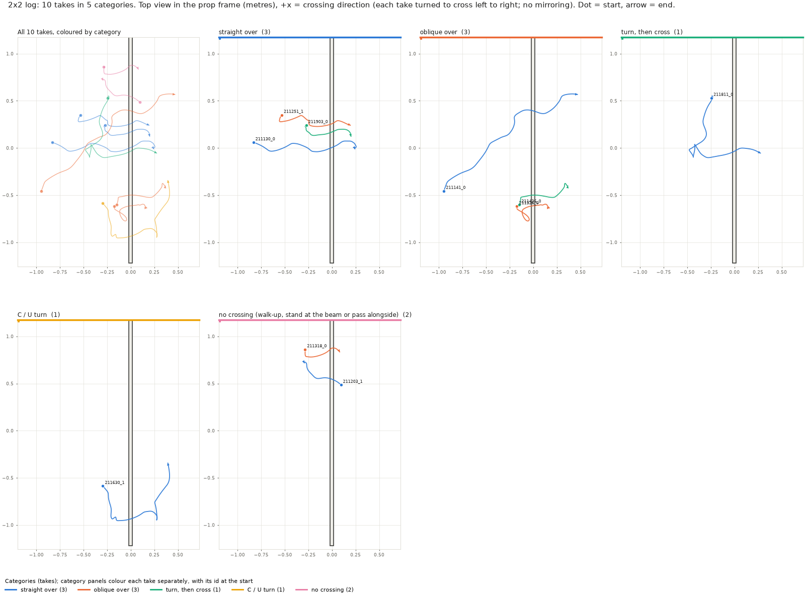

| Category | Takes | abs body x | abs path x | abs turn before | abs turn after | sideways share | backward share | seconds | Take ids |
| --- | --- | --- | --- | --- | --- | --- | --- | --- | --- |
| straight over | 3 | 1 (1 to 15) | 14 (12 to 22) | 6 (0 to 25) | 19 (10 to 31) | 0.00 (0.00 to 0.00) | 0.00 (0.00 to 0.00) | 5.9 (5.4 to 6.0) | 211130_0, 211251_1, 211903_0 |
| oblique over | 3 | 42 (36 to 61) | 1 (0 to 22) | 3 (2 to 22) | 24 (11 to 26) | 0.05 (0.04 to 0.63) | 0.00 (0.00 to 0.04) | 3.9 (3.8 to 6.0) | 211141_0, 211326_0, 211436_0 |
| turn, then cross | 1 | 6 | 13 | 171 | 5 | 0.41 | 0.15 | 6.0 | 211811_0 |
| C / U turn | 1 | 3 | 17 | 61 | 89 | 0.14 | 0.00 | 6.0 | 211630_1 |
| no crossing (walk-up, stand at the beam or pass alongside) | 2 | - | - | - | - | 0.10 (0.07 to 0.13) | 0.00 (0.00 to 0.00) | 3.1 (2.5 to 3.8) | 211203_1, 211318_0 |

Median (min to max) over the takes of the category; abs = absolute value. Ids are short for `pico_20261029_211203_1_2x2`.

### 2x2 log: straight over (3)

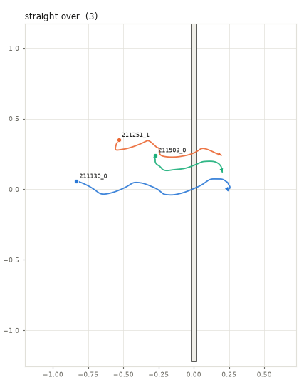 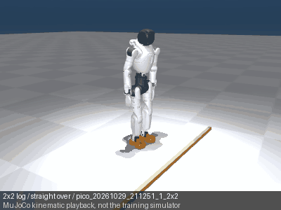

GIFs: `211251_1` medoid (typical).

### 2x2 log: oblique over (3)

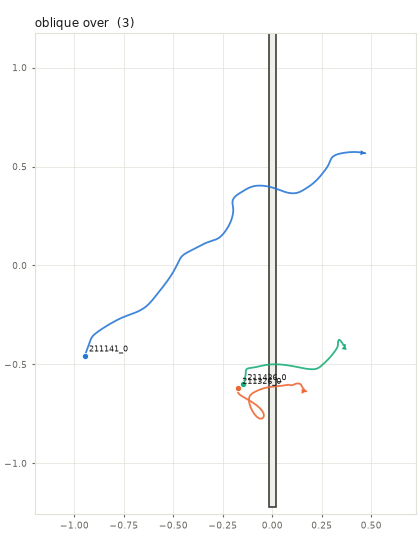 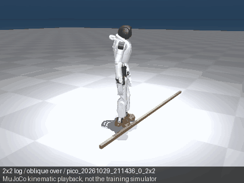

GIFs: `211436_0` medoid (typical).

### 2x2 log: turn, then cross (1)

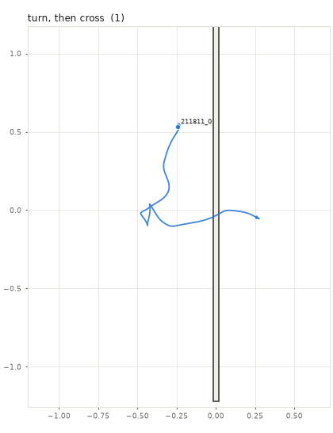 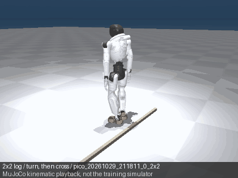

GIFs: `211811_0` medoid (typical).

### 2x2 log: C / U turn (1)

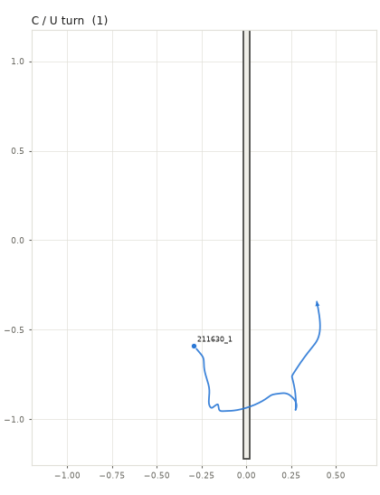 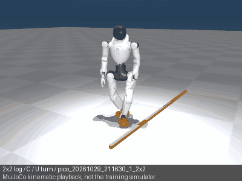

GIFs: `211630_1` medoid (typical).

### 2x2 log: no crossing (walk-up, stand at the beam or pass alongside) (2)

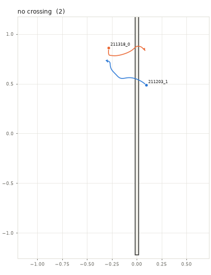 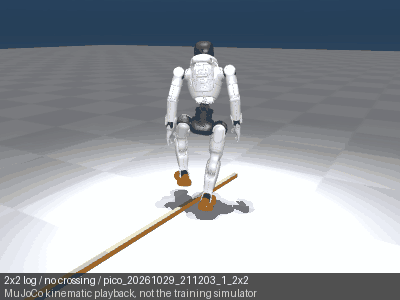

GIFs: `211203_1` medoid (typical).

## Stairs, place 1 (38 takes)

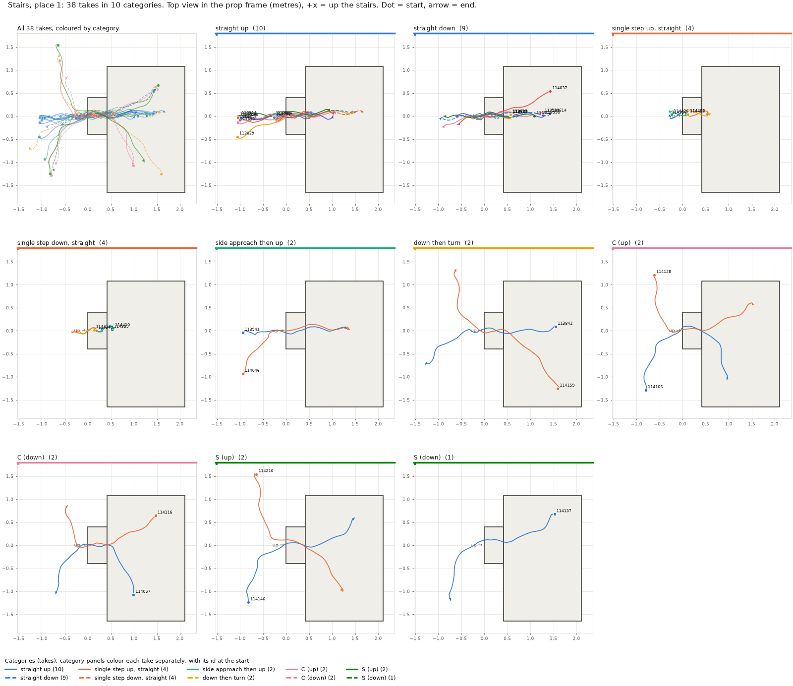

| Category | Takes | abs turn low deg | abs turn high deg | abs facing off deg | root z gain m | sideways share | seconds | Take ids |
| --- | --- | --- | --- | --- | --- | --- | --- | --- |
| straight up | 10 | 2 (0 to 23) | 3 (1 to 9) | 2 (1 to 6) | 0.27 (0.26 to 0.28) | 0.00 (0.00 to 0.03) | 7.6 (5.2 to 17.4) | 113624, 113730, 113751, 113829, 113853, 113914, 114001, 114515, 114553, 114630 |
| straight down | 9 | 3 (0 to 39) | 5 (2 to 30) | 4 (2 to 6) | -0.26 (-0.26 to -0.25) | 0.00 (0.00 to 0.23) | 5.7 (4.7 to 15.9) | 113633, 113717, 113739, 113817, 113902, 113923, 113950, 114037, 114614 |
| single step up, straight | 4 | 2 (1 to 3) | 1 (0 to 5) | 6 (5 to 7) | 0.13 (0.10 to 0.18) | 0.00 (0.00 to 0.00) | 4.5 (4.3 to 5.2) | 114356, 114403, 114426, 114432 |
| single step down, straight | 4 | 2 (1 to 6) | 0 (0 to 4) | 3 (0 to 8) | -0.13 (-0.18 to -0.09) | 0.27 (0.14 to 0.35) | 4.4 (3.6 to 6.1) | 114339, 114349, 114410, 114417 |
| side approach then up | 2 | 70 (63 to 76) | 15 (7 to 23) | 14 (1 to 27) | 0.28 (0.28 to 0.28) | 0.23 (0.01 to 0.45) | 6.8 (6.5 to 7.1) | 113941, 114046 |
| down then turn | 2 | 84 (63 to 104) | 22 (2 to 42) | 14 (3 to 24) | -0.27 (-0.27 to -0.27) | 0.01 (0.00 to 0.03) | 8.9 (8.0 to 9.8) | 113842, 114159 |
| C (up) | 2 | 96 (90 to 102) | 82 (71 to 92) | 16 (16 to 16) | 0.26 (0.25 to 0.26) | 0.01 (0.00 to 0.02) | 7.6 (7.5 to 7.7) | 114106, 114128 |
| C (down) | 2 | 68 (54 to 81) | 75 (61 to 89) | 12 (4 to 21) | -0.27 (-0.27 to -0.26) | 0.06 (0.00 to 0.11) | 6.5 (6.3 to 6.8) | 114057, 114116 |
| S (up) | 2 | 73 (68 to 78) | 78 (55 to 100) | 6 (2 to 11) | 0.27 (0.24 to 0.29) | 0.00 (0.00 to 0.00) | 8.0 (7.0 to 9.0) | 114146, 114210 |
| S (down) | 1 | 88 | 53 | 8 | -0.27 | 0.00 | 6.9 | 114137 |

Median (min to max) over the takes of the category; abs = absolute value. Ids are short for `tp_stairs_114137`.

### Stairs, place 1: straight up (10)

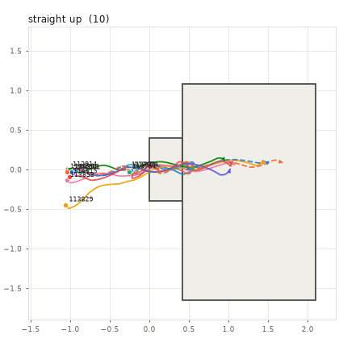 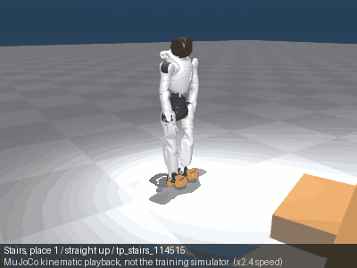 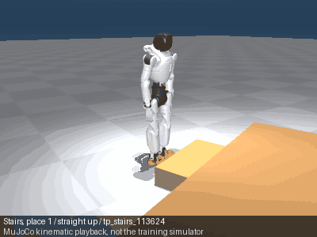

GIFs: `114515` medoid (typical), x2.4 speed; `113624` farthest from the medoid.

### Stairs, place 1: straight down (9)

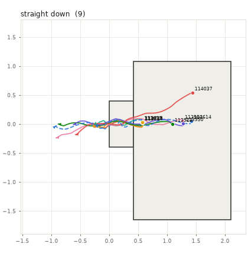 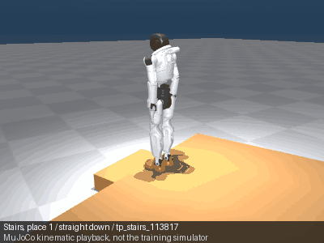 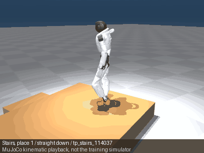

GIFs: `113817` medoid (typical); `114037` farthest from the medoid.

### Stairs, place 1: single step up, straight (4)

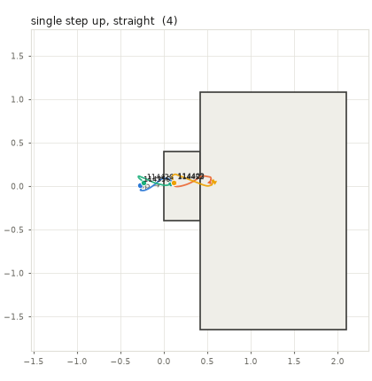 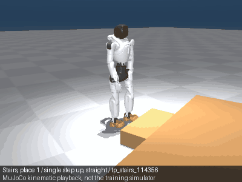 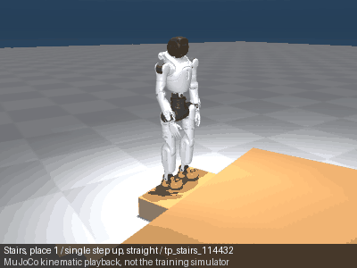

GIFs: `114356` medoid (typical); `114432` farthest from the medoid.

### Stairs, place 1: single step down, straight (4)

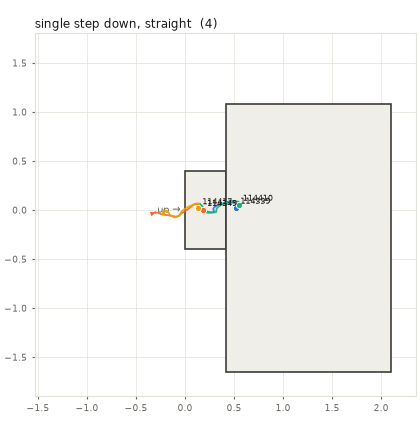 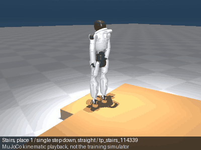 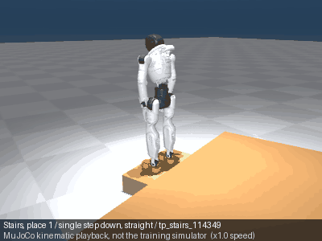

GIFs: `114339` medoid (typical); `114349` farthest from the medoid, x1.0 speed.

### Stairs, place 1: side approach then up (2)

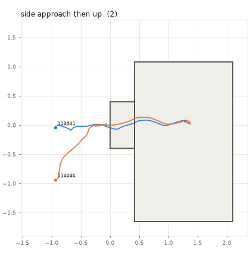 

GIFs: `113941` medoid (typical), x1.1 speed.

### Stairs, place 1: down then turn (2)

 

GIFs: `113842` medoid (typical), x1.6 speed.

### Stairs, place 1: C (up) (2)

 

GIFs: `114106` medoid (typical), x1.2 speed.

### Stairs, place 1: C (down) (2)

 

GIFs: `114057` medoid (typical), x1.1 speed.

### Stairs, place 1: S (up) (2)

 

GIFs: `114146` medoid (typical), x1.2 speed.

### Stairs, place 1: S (down) (1)

 

GIFs: `114137` medoid (typical), x1.2 speed.

## Stairs, place 2 (6 takes)

| Category | Takes | abs turn low deg | abs turn high deg | abs facing off deg | root z gain m | sideways share | seconds | Take ids |
| --- | --- | --- | --- | --- | --- | --- | --- | --- |
| single step up, straight | 3 | 1 (0 to 21) | 0 (0 to 7) | 14 (12 to 17) | 0.15 (0.14 to 0.16) | 0.05 (0.00 to 0.20) | 5.4 (5.1 to 5.7) | 114251, 114258, 114324 |
| single step down, straight | 1 | 1 | 0 | 21 | -0.16 | 0.26 | 4.7 | 114315 |
| down then turn | 2 | 55 (53 to 57) | 30 (26 to 35) | 21 (20 to 22) | -0.28 (-0.28 to -0.28) | 0.00 (0.00 to 0.00) | 6.5 (5.4 to 7.6) | 114221, 114241 |

Median (min to max) over the takes of the category; abs = absolute value. Ids are short for `tp_stairs_114221`.

### Stairs, place 2: single step up, straight (3)

 

GIFs: `114324` medoid (typical).

### Stairs, place 2: single step down, straight (1)

 

GIFs: `114315` medoid (typical).

### Stairs, place 2: down then turn (2)

 

GIFs: `114221` medoid (typical).

## Ramp (15 takes)

Earlier classification: 10 straight, 3 oblique, 2 L (15 base takes).

| Category | Takes | path on slope x | body on slope x | abs turn before | abs turn after | root z gain m | sideways share | seconds | Take ids |
| --- | --- | --- | --- | --- | --- | --- | --- | --- | --- |
| straight up | 3 | 3 (-1 to 6) | -1 (-16 to 2) | 2 (1 to 4) | 0 (0 to 0) | 0.21 (0.21 to 0.22) | 0.00 (0.00 to 0.02) | 8.5 (6.0 to 11.4) | 120145, 120212, 120556 |
| oblique up | 1 | -19 | -43 | 7 | 0 | 0.19 | 0.24 | 9.3 | 120237 |
| straight down | 2 | -174 (-175 to -174) | 178 (177 to 179) | 0 (0 to 1) | 8 (4 to 11) | -0.15 (-0.15 to -0.15) | 0.07 (0.00 to 0.14) | 8.0 (6.3 to 9.7) | 120224, 120605 |
| oblique down | 1 | -149 | -80 | 0 | 34 | -0.17 | 0.46 | 13.3 | 120441 |
| down, then turn | 1 | -175 | -176 | 2 | 109 | -0.21 | 0.03 | 16.7 | 120413 |
| over the ramp side to side | 7 | 87 (-83 to 99) | 84 (-84 to 93) | 8 (3 to 12) | 19 (3 to 36) | 0.00 (-0.02 to 0.03) | 0.00 (0.00 to 0.04) | 7.8 (6.8 to 14.5) | 120312, 120330, 120524, 120535, 120545, 120626, 120637 |

Median (min to max) over the takes of the category; abs = absolute value. Ids are short for `tp_ramp_120312`.

### Ramp: straight up (3)

 

GIFs: `120556` medoid (typical).

### Ramp: oblique up (1)

 

GIFs: `120237` medoid (typical), x1.6 speed.

### Ramp: straight down (2)

 

GIFs: `120224` medoid (typical), x1.6 speed.

### Ramp: oblique down (1)

 

GIFs: `120441` medoid (typical), x2.2 speed.

### Ramp: down, then turn (1)

 

GIFs: `120413` medoid (typical), x2.8 speed.

### Ramp: over the ramp side to side (7)

  

GIFs: `120330` medoid (typical), x2.4 speed; `120312` farthest from the medoid, x1.4 speed.

## Driveway (6 takes)

| Category | Takes | net travel x | root z gain m | abs turn total | seconds | Take ids |
| --- | --- | --- | --- | --- | --- | --- |
| straight uphill | 2 | -11 (-12 to -10) | 0.35 (0.30 to 0.40) | 11 (5 to 17) | 8.1 (6.9 to 9.3) | 121023, 121119 |
| straight downhill | 1 | 176 | -0.33 | 42 | 9.5 | 121035 |
| diagonal across the slope | 3 | 50 (-63 to 118) | 0.12 (-0.06 to 0.16) | 14 (5 to 30) | 7.3 (6.2 to 8.0) | 121046, 121056, 121106 |

Median (min to max) over the takes of the category; abs = absolute value. Ids are short for `tp_driveway_121046`.

### Driveway: straight uphill (2)

 

GIFs: `121023` medoid (typical), x1.6 speed.

### Driveway: straight downhill (1)

 

GIFs: `121035` medoid (typical), x1.6 speed.

### Driveway: diagonal across the slope (3)

 

GIFs: `121106` medoid (typical), x1.0 speed.

